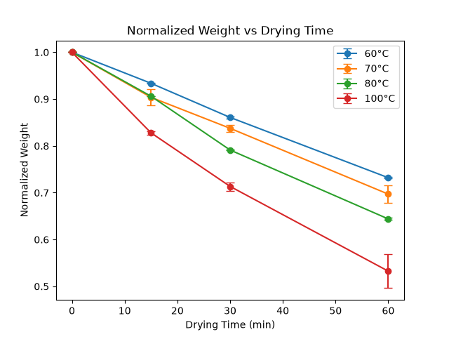
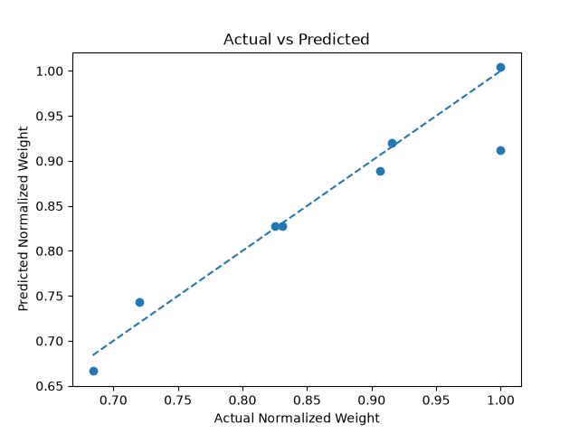
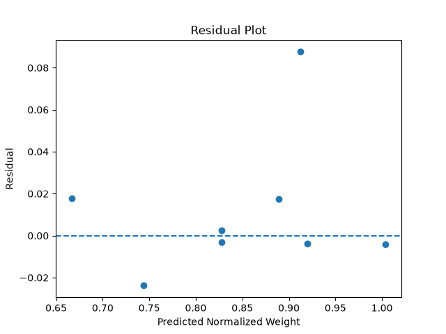

# Machine Learning Analysis of Potato Drying Experiments

## Overview

This project explores the application of machine learning to
experimental potato drying data.

The objective was to predict normalized sample weight as a function
of oven temperature and drying time, while comparing different
regression models and validation strategies.

## Dataset

The dataset contains 32 experimental observations collected at:

- Oven temperatures: 60, 70, 80, and 100 °C
- Drying times: 0, 15, 30, and 60 min
- Two replicate samples for each temperature

The dataset also contains several temperature measurements, although
these variables contain missing values and were not used as predictors
in the current ML models.

## Feature Engineering

To account for differences in initial sample weight, normalized weight
was calculated as:

Normalized Weight = Current Weight / Initial Weight

Therefore, every sample has a normalized weight of 1 at time zero.

Note: normalized weight should not be interpreted as moisture ratio.

## Machine Learning Problem

Inputs:

- Oven temperature
- Drying time

Target:

- Normalized weight

This is therefore a supervised regression problem.

## Models

Two regression models were evaluated:

1. Linear Regression
2. Random Forest Regressor

## Linear Regression Results

Test results:

| Metric | Value |
|---|---:|
| MAE | 0.0200 |
| RMSE | 0.0334 |
| R² | 0.908 |

The fitted model was approximately:

Normalized Weight =
1.2177
- 0.00305 × Temperature
- 0.00563 × Time

Both coefficients were negative, consistent with the observed decrease
in normalized weight with increasing temperature and drying time.

## Random Forest Results

| Metric | Train | Test |
|---|---:|---:|
| RMSE | 0.0114 | 0.0296 |
| R² | 0.9939 | 0.9279 |

Random Forest produced a lower test RMSE on this particular train/test
split, but also showed a larger train-test performance gap.

## Cross-Validation

Because the dataset is small, model performance was also evaluated
using multiple validation strategies.

### Standard 5-fold CV

| Model | Mean RMSE | SD |
|---|---:|---:|
| Linear Regression | 0.0417 | 0.0195 |
| Random Forest | 0.0311 | 0.0273 |

### GroupKFold by experimental sample

| Model | Mean RMSE | SD |
|---|---:|---:|
| Linear Regression | 0.0329 | 0.0089 |
| Random Forest | 0.0206 | 0.0095 |

Group-aware validation prevents measurements belonging to the same
sample trajectory from being split between training and validation.

## Generalization to Unseen Temperatures

Leave-one-temperature-out validation was used to investigate
generalization to temperatures not present in the training set.

| Model | Mean RMSE |
|---|---:|
| Linear Regression | 0.0369 |
| Random Forest | 0.0425 |

This experiment highlighted an important distinction between
interpolation and extrapolation.

Random Forest performed well when predicting samples within the
experimental temperature range, but its performance deteriorated when
extrapolating to an unseen high temperature.

## Hyperparameter Tuning

Random Forest hyperparameters were optimized using GridSearchCV with
GroupKFold.

Best configuration:

- n_estimators = 200
- max_depth = None

Best group-CV RMSE:

0.0195

## Feature Importance

Random Forest feature importance:

| Feature | Importance |
|---|---:|
| Drying time | 0.871 |
| Oven temperature | 0.129 |

These values describe how strongly the fitted Random Forest relied on
each feature. They should not be interpreted as causal contributions.

## Key Lessons

This project demonstrates that model evaluation depends not only on
the algorithm but also on the validation strategy.

A model that performs well when predicting new samples at known
experimental conditions may not perform equally well when extrapolating
to completely unseen operating conditions.

This distinction is particularly important when applying machine
learning to experimental engineering data.

## Limitations

The dataset contains only 32 observations.

The current target is normalized weight rather than physically defined
moisture content or moisture ratio.

Additional experimental data would be required before using these
models for reliable prediction outside the measured operating range.

## Technologies

- Python
- pandas
- NumPy
- Matplotlib
- scikit-learn

## Experimental Trends

Normalized weight decreased with drying time, with faster weight
reduction observed at higher oven temperatures.

## Model Diagnostics

